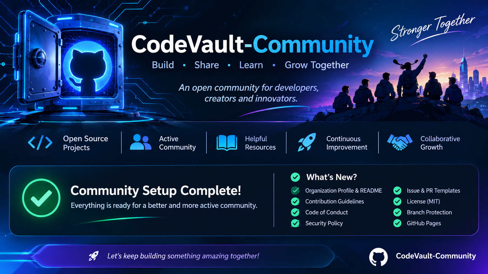

# CodeVault-Community

### Build. Learn. Share. Collaborate.

Welcome to **CodeVault-Community**, an open-source community focused on building useful software, sharing knowledge, and helping developers grow together. Our featured project is [CodeVault](https://github.com/CodeVault-Community/CodeVault), a local-first library for saving, organizing, and reusing code snippets.

## 🎯 Our Mission

Our mission is to create a collaborative environment where developers can:

- Build practical open-source software.
- Learn programming through real-world projects.
- Share ideas, knowledge, and experience.
- Collaborate with developers from different backgrounds.
- Create tools that solve meaningful problems.

## 🚀 What We Do

- **Open Source:** Build and maintain community-driven projects.
- **Education:** Learn through documentation, examples, and practical development.
- **Innovation:** Explore ideas and turn them into useful software.
- **Community:** Welcome contributors and encourage collaboration.

## 🤝 How to Contribute

We welcome developers, learners, designers, and technical writers.

1. Explore our repositories.
2. Check open issues and project discussions.
3. Read the project's contribution guidelines.
4. Read our [contributing guidelines](https://github.com/CodeVault-Community/.github/blob/main/CONTRIBUTING.md).
5. Submit a pull request and share feedback.

Please also review our [Code of Conduct](https://github.com/CodeVault-Community/.github/blob/main/CODE_OF_CONDUCT.md) and [security policy](https://github.com/CodeVault-Community/.github/blob/main/SECURITY.md).

Every meaningful contribution matters.

## 🌍 Our Values

- Openness
- Respect
- Collaboration
- Learning
- Quality
- Transparency

## 💡 Build Something Meaningful With Us

**CodeVault-Community is built by people who believe software is better when we build it together.**
